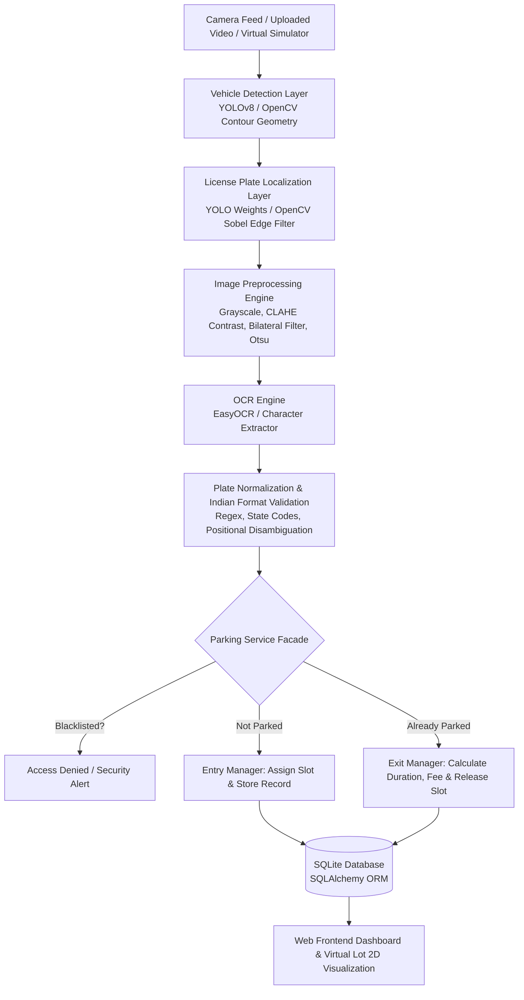

# Chapter 6: System Architecture

## 6.1 Architectural Block Diagram

## 6.2 Component Interactions
- **Presentation Tier:** Built using HTML5, modern Vanilla CSS, and JavaScript. Connects with backend endpoints via asynchronous Fetch API polling.
- **Application Services Tier:** Developed in Flask, structured around modular blueprints: `auth`, `dashboard`, `vehicles`, `analytics`, and `api`.
- **AI / ANPR Engine Tier:** Executes computer vision detection on incoming image matrices using OpenCV, Ultralytics YOLO, and EasyOCR.
- **Persistence Tier:** Encapsulated in SQLite via SQLAlchemy ORM, enforcing foreign key relationships and transaction isolation.
